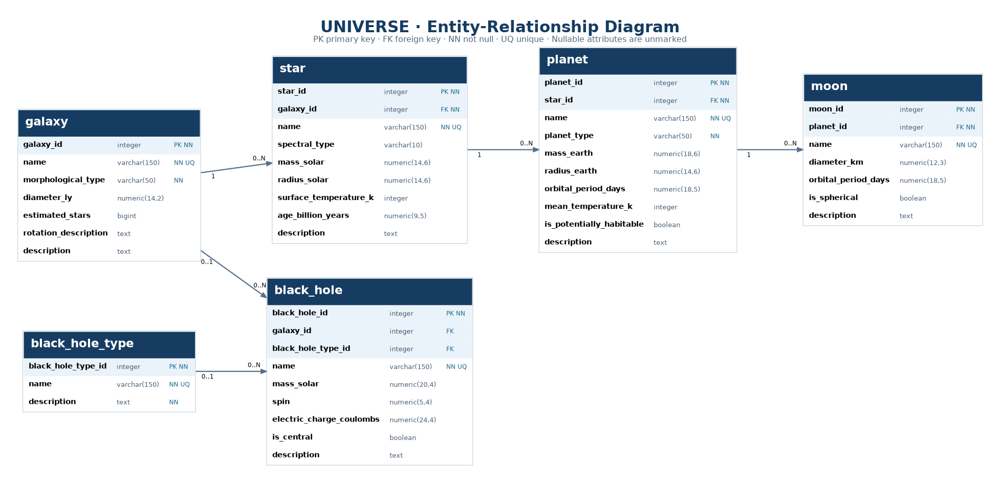

# Celestial Bodies Database — Universe

A relational astronomical catalog built with **PostgreSQL** for the freeCodeCamp **Relational Database** certification project, extended beyond the minimum requirements with a black-hole classification catalog, physical-property checks, and indexes on foreign keys.

## Project overview

The `universe` database stores galaxies, stars, planets, moons, black holes, and black-hole classifications. It models their relationships using primary and foreign keys, while allowing unknown scientific measurements to remain `NULL`.

**Included in the database dump:** 6 tables, 50 sample records, 5 foreign keys, and 17 indexes (6 primary-key indexes, 6 unique-name indexes, and 5 additional foreign-key indexes).

## Entity-relationship diagram



The model has five one-to-many relationships:

- `galaxy` → `star` (each star must reference a galaxy)
- `star` → `planet` (each planet must reference a star)
- `planet` → `moon` (each moon must reference a planet)
- `galaxy` → `black_hole` (a black hole's galaxy reference is optional)
- `black_hole_type` → `black_hole` (a black hole's type reference is optional)

The diagram indicates mandatory versus nullable foreign keys. It does not imply that every parent has at least one child.

## Database schema

| Table | Rows | Purpose |
| --- | ---: | --- |
| `galaxy` | 6 | Galaxy names, morphology, approximate size and stellar populations |
| `star` | 6 | Stars and their parent galaxies, spectral and physical attributes |
| `planet` | 12 | Planets and their host stars, orbital and physical attributes |
| `moon` | 20 | Natural satellites and their parent planets |
| `black_hole` | 3 | Black holes, properties, centrality, galaxy and classification references |
| `black_hole_type` | 3 | Stellar, intermediate and supermassive classification entries |

All six tables use `INTEGER` identity primary keys named `<table>_id` and a `VARCHAR(150) NOT NULL UNIQUE` `name` column. Five foreign keys use `ON DELETE RESTRICT` and `ON UPDATE RESTRICT`. Physical quantities use documented units in column names (such as `diameter_ly`, `mass_solar`, and `orbital_period_days`) and have `CHECK` constraints for suitable ranges. Text descriptions use `TEXT`, and yes/no observations use nullable `BOOLEAN` fields.

### Modeling decisions

- **Classification lookup:** `black_hole_type` stores category names and descriptions rather than duplicating descriptive text in each black-hole record.
- **Unknown values:** nullable attributes distinguish missing measurements from known numerical zero or `FALSE`.
- **Integrity:** foreign keys prevent orphaned records; `RESTRICT` protects referenced parent records from accidental deletion or key changes.
- **Central black holes:** `is_central = TRUE` requires a non-null `galaxy_id`; the schema intentionally does not limit a galaxy to one recorded central black hole.
- **Indexes:** additional B-tree indexes cover the five foreign-key columns; performance benefits depend on dataset size and query plans.

## Getting started

### Requirements

- PostgreSQL (the dump was created with PostgreSQL **12.22**)
- A PostgreSQL role named `freecodecamp` with sufficient privileges to create and own the database
- The `psql` client

### Restore the database

**Warning:** the supplied `universe.sql` contains `DROP DATABASE universe;` followed by `CREATE DATABASE universe;`. Restoring it will **delete any existing database named `universe`**. Run it only in an environment where that is safe.

From your shell (not from inside the `psql` prompt):

```bash
psql -U freecodecamp -d postgres -f universe.sql
```

The script reconnects to `universe`, creates its schema, inserts its data, restores sequence positions, and creates constraints and indexes. If your PostgreSQL instance does not have the `freecodecamp` role or matching privileges, adapt the role/ownership statements in a **separate copy** of the dump before restoring it.

To inspect the result:

```bash
psql -U freecodecamp -d universe
```

```sql
\dt
SELECT COUNT(*) FROM moon;
\d black_hole
```

## Example SQL queries

### Planets and their host stars

```sql
SELECT p.name AS planet, s.name AS host_star, p.planet_type
FROM planet AS p
JOIN star AS s ON s.star_id = p.star_id
ORDER BY s.name, p.name;
```

### Number of cataloged moons per planet (including zero)

```sql
SELECT p.name AS planet, COUNT(m.moon_id) AS cataloged_moons
FROM planet AS p
LEFT JOIN moon AS m ON m.planet_id = p.planet_id
GROUP BY p.planet_id, p.name
ORDER BY cataloged_moons DESC, p.name;
```

### Black holes with galaxy and classification

```sql
SELECT bh.name AS black_hole,
       g.name AS galaxy,
       bht.name AS classification,
       bh.mass_solar,
       bh.is_central
FROM black_hole AS bh
LEFT JOIN galaxy AS g ON g.galaxy_id = bh.galaxy_id
LEFT JOIN black_hole_type AS bht
  ON bht.black_hole_type_id = bh.black_hole_type_id
ORDER BY bh.mass_solar DESC NULLS LAST;
```

## Scope and limitations

This is an educational catalog, not a research-grade astronomical database. Measurements are approximate and may vary with observational methods. A planet is linked to one star, so circumbinary systems are not represented in full. Object classifications and habitability indicators are simplified, and this version does not store measurement provenance, uncertainty bounds or observation dates.


## Repository structure

```text
fcc-celestial-bodies-database/
├── universe.sql
├── README.md
└── docs/
    └── er-diagram.png
```
